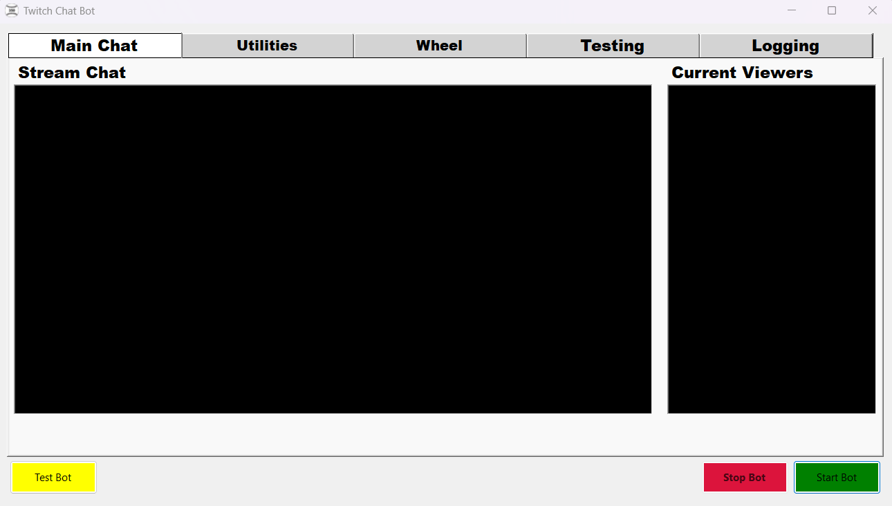
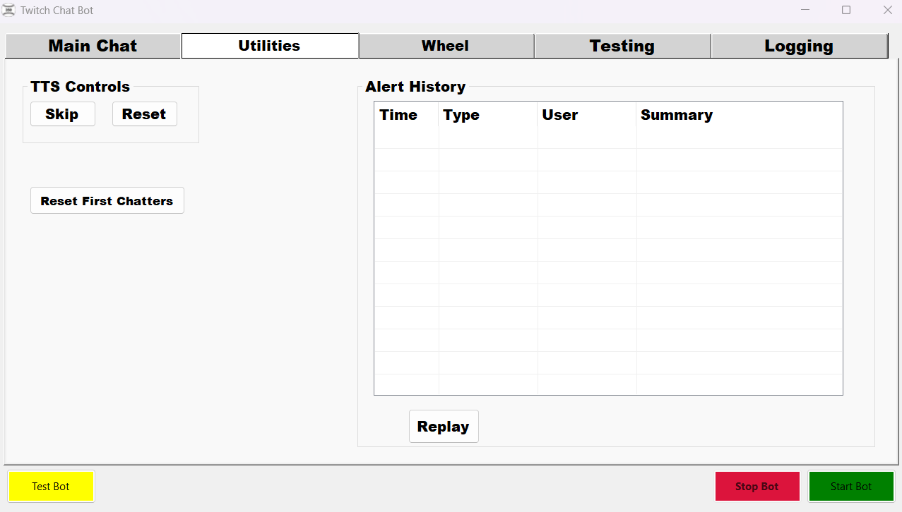
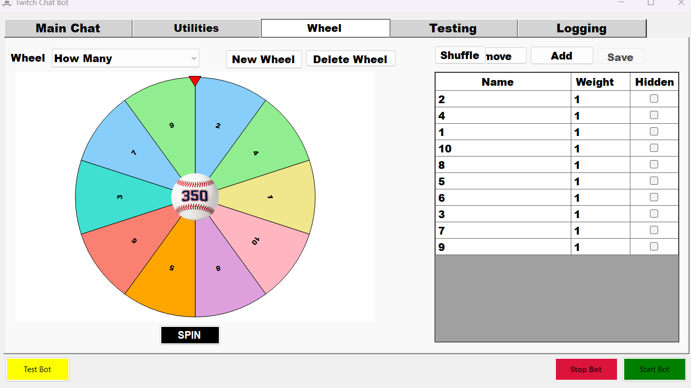
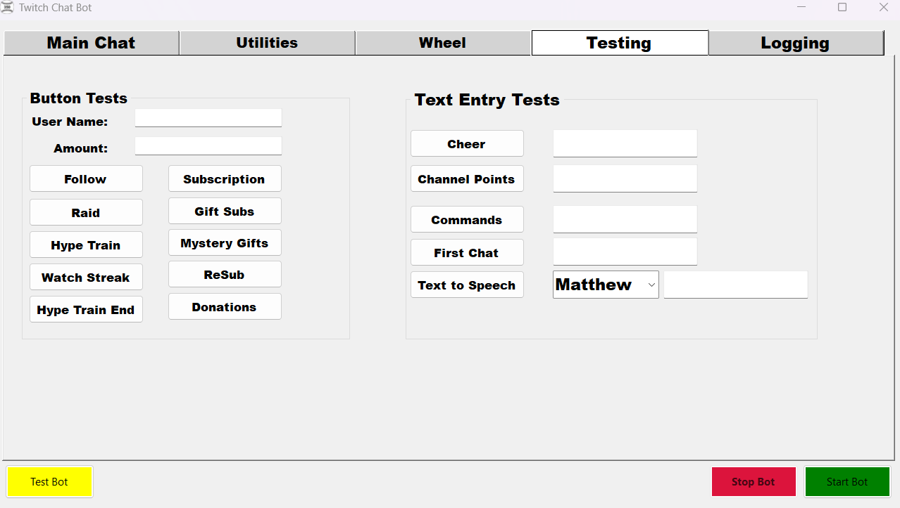
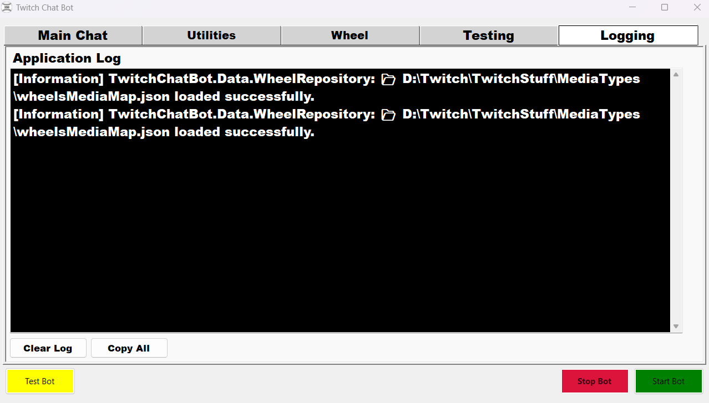

# Twitch Chat Bot — User Guide

This guide describes TwitchChatBot version 3.0.2 and explains the five tabs in the Windows desktop application and its main controls. Installation and repository setup are documented in the [README](../README.md).

Related setup: [Configuration](CONFIGURATION.md) · [Twitch](TWITCH_SETUP.md) · [AWS Polly](AWS_POLLY_SETUP.md) · [Streamlabs](STREAMLABS_SETUP.md) · [OpenAI](OPENAI_SETUP.md)

> **Before you start:** Configure your Twitch channel and the optional services you plan to use. Test features can still invoke live services and may incur OpenAI or AWS Polly charges. Never put access tokens or API keys in screenshots, logs you share, or your repository.

## Getting started

1. Launch the Windows application using the documented installation or build instructions in the README.
2. Check your configuration before connecting to Twitch.
3. Click **Start Bot** to start the normal bot session.
4. Use **Stop Bot** to request a stop of the current bot session.

**Test Bot** starts a testing-mode session but **is not an offline sandbox**. It can still connect to Twitch and third-party services, send real chat messages, trigger overlays, and incur external API charges. Do not confuse Test Bot with the individual controls on the Testing tab.

The **Start Bot**, **Test Bot**, and **Stop Bot** controls remain visible at the bottom of the window on all tabs. During startup, the start controls are disabled to prevent overlapping attempts. The enabled buttons reflect the controller's startup state, which does not guarantee every optional external provider is ready.

## Main Chat



The **Main Chat** tab provides two read-only displays:

- **Stream Chat** shows messages received through the bot's configured Twitch chat connection.
- **Current Viewers** shows viewer and role information available through the application's viewer-tracking mechanisms. Treat this as an application display, not a guaranteed complete list of everyone watching.

These are display areas, not message-composition fields. Use the persistent controls at the bottom to start or stop the bot.

## Utilities



### TTS controls

- **Skip** stops the current TTS message, including audio already playing in connected current-version alert overlays. Later queued TTS is preserved.
- **Reset** stops current TTS and clears pending TTS. It is intended to leave non-TTS alerts unaffected and allow new speech afterward.

If Skip or Reset does not affect OBS audio after an application update, refresh the OBS Browser Source cache to load the current `alerts.html`. A stale overlay may lack the required cancellation handlers.

### First chatters

**Reset First Chatters** clears the current in-memory first-chatter tracking. Use it only when you intentionally want the application to regard chatters as eligible for first-chat processing again.

### Alert History

The list displays **Time**, **Type**, **User**, and **Summary** for recorded alerts. Select a record and click **Replay** (or double-click a record) to replay it.

**Important:** Replay is not necessarily a visual-only preview. Depending on the alert configuration it may invoke TTS, commands, or other integrated behavior. The history is a bounded in-memory collection rather than a permanent audit log.

## Wheel



1. Choose an existing wheel in the **Wheel** dropdown or click **New Wheel** to create one.
2. Edit entries in the grid on the right:
   - **Name** is the text shown for the entry.
   - **Weight** is a positive number controlling its relative chance of selection. Larger numbers are more likely to win.
   - **Hidden** excludes an entry from selection and the visible wheel.
3. Click **Add Entry** to stage a new row, or **Remove Entry** to stage removal of the selected row.
4. Click **Save** to persist changes. Invalid names, weights, or duplicate names are rejected without partially saving the wheel.
5. Click **Shuffle** to randomize entry order and persist the updated order.
6. Click **SPIN** to choose a weighted winner and display the result. Confirming the result can dispatch the entry's configured alert.

**Unsaved edits:** Spin and Shuffle prompt you to **Save**, **Discard**, or **Cancel/Keep Editing**. An unsuccessful save prevents the requested action and preserves your edits. The wheel cannot spin if there are no eligible, non-hidden entries.

**Delete Wheel** permanently deletes the selected wheel after confirmation. Use it carefully.

### Optional center branding image

You can display **one center branding image shared by every wheel**, such as your channel logo or emote. The image is **not configured separately for each wheel**; there are no Choose/Clear Image buttons on the Wheel tab. The branding appears at the center of the wheel, stays stationary during spinning, preserves its aspect ratio, and is displayed at 20% of the wheel diameter. It does not change entry weights or who wins.

To configure it, open your local application configuration and set `UiMedia:WheelCenterBranding`, for example:

```json
"UiMedia": {
  "WheelCenterBranding": "Wheel/centerWheel.png"
}
```

- **Supported:** `.png`, `.jpg`, `.jpeg`; transparent PNGs are supported. **GIF is not supported.**
- **Relative path:** Resolved beneath the folder configured by `MediaBase:TwitchAlertsFolder`. The example above points to a file inside that media folder's `Wheel` subfolder.
- **Absolute path:** Also supported, but avoid publishing personal paths in the repository or screenshots.
- **Change the image:** Replace the referenced image file or change the `WheelCenterBranding` value to another supported image path.
- **Remove the image:** Set `WheelCenterBranding` to an empty string (`""`). Without a configured, readable image, the wheel displays normally without center branding.
- **Apply the change:** Restart the application. You **do not** need to recompile it.

The public `appsettings.example.json` intentionally leaves the setting empty. Edit your local configuration rather than committing personal image paths or credentials. See [Configuration](CONFIGURATION.md) for the complete configuration conventions.

## Testing



The Testing tab contains **Button Tests** on the left and **Text Entry Tests** on the right. These controls exercise real application paths; they are **not isolated from production integrations**. Test actions can trigger alerts, chat, persistence, third-party API requests, and paid TTS or AI generation. Each action has short repeat-click protection, not a permanent duplicate filter.

### Button Tests

Set **User Name** and **Amount** as appropriate, then click the test you want to run:

| Test | Input / behavior |
|---|---|
| Follow | Simulates a follow using User Name |
| Subscription | Simulates a subscription using User Name |
| Raid | Uses User Name and Amount as a positive viewer count |
| Gift Subs | Uses User Name as the gifter and Amount as the recipient username |
| Hype Train | Simulates Hype Train start |
| Mystery Gifts | Uses Amount as the positive number of gifted subscriptions |
| Watch Streak | Uses User Name and Amount as a positive streak count |
| ReSub | Uses User Name and Amount as positive resubscription months |
| Hype Train End | Simulates the configured end-of-train event |
| Donations | Uses User Name and Amount as a positive decimal donation value |

**Amount is context-dependent.** For example, it means viewers for Raid but months for ReSub and a username for Gift Subs. Invalid numeric values receive nonmodal validation feedback and are not submitted.

### Text Entry Tests

| Test | Input / behavior |
|---|---|
| Cheer | Enter a positive whole number of bits |
| Channel Points | Enter a configured reward title |
| Commands | Enter the command name, without a leading `!` |
| First Chat | Enter the username for a simulated first-chat event |
| Text to Speech | Select a voice and enter the speech text |

A blank required input is rejected. Some actions may have no visible result if the corresponding alert, reward, or service is not configured or the event is not eligible.

**AI and TTS fallback:** For eligible ReSub, Mystery Gifts, and Watch Streak events, the application can use a configured or default fallback spoken message when AI text generation returns no usable text. This does not make external requests free, nor does it mean speech plays when TTS is unavailable.

## Logging



The **Application Log** displays diagnostic messages and service information.

- **Clear Log** removes the text currently shown on screen. It does not turn off logging or prevent subsequent messages from appearing.
- **Copy All** copies the visible log text to the clipboard, making it easier to share an error report.

New log messages can appear after you clear the display. Review copied logs for sensitive local paths or other information before sharing them.

## Troubleshooting

| Problem | What to check |
|---|---|
| Bot does not connect | Review Application Log and your configured Twitch credentials/permissions; a started controller does not guarantee each provider is ready |
| OBS alert audio does not respond to Skip/Reset | Refresh the OBS Browser Source **cache**, verify its URL and port, and ensure it is connected to the current bot instance |
| Testing button appears to do nothing | Check required inputs and application logs, then confirm the corresponding integration or alert configuration exists |
| Unexpected repeated alert | Avoid intentionally clicking a test again after its short repeat-click interval; tests accept subsequent deliberate submissions |
| TTS does not play | Verify AWS Polly configuration and the overlay connection; use logs to diagnose service errors |
| Wheel changes are missing | Save staged entry edits; when prompted during Spin/Shuffle, choose Save to use the new values |

For integration-specific configuration, consult [Configuration](CONFIGURATION.md). This guide describes observed UI behavior; optional integrations only function when configured and available.
